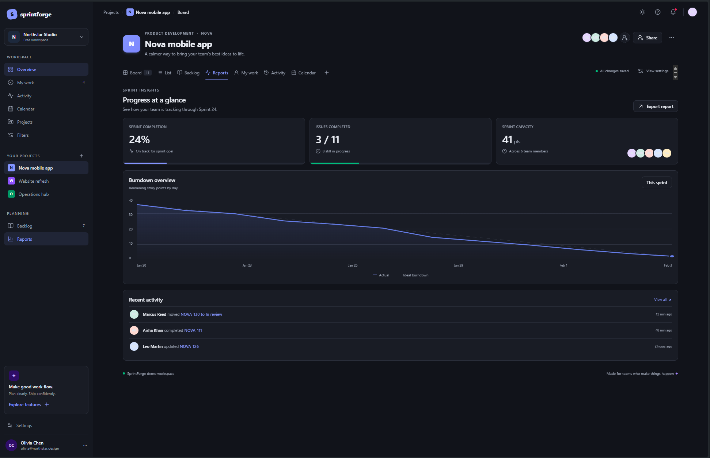
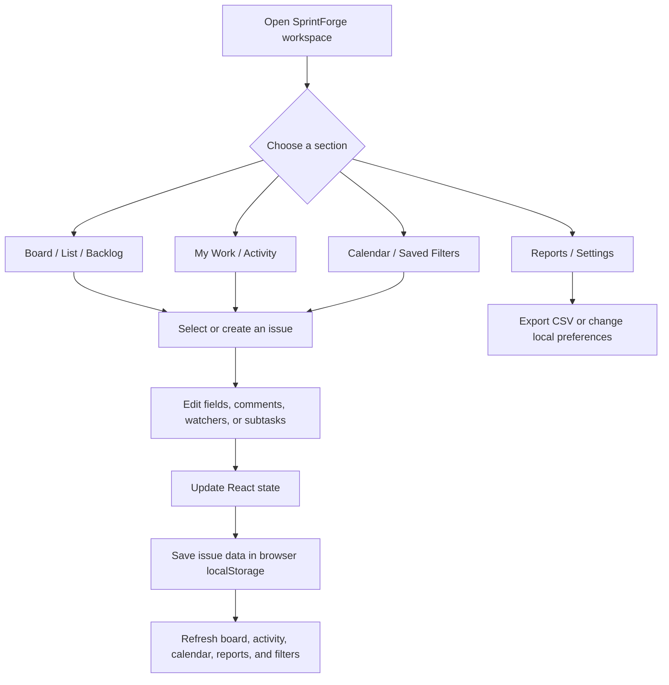

# SprintForge — Project planning workspace

A frontend-only project-planning workspace built with React and TypeScript. It borrows familiar patterns from modern issue trackers, with original branding and UI. There is no backend in this repository; fictional demo data and edits are stored in browser `localStorage`.



## Features

- Board, list, backlog, sprint insights, My Work, project Activity, and due-date Calendar
- Drag issues between board columns; open an issue detail panel from lists, calendar, activity, and filters
- Create and edit issue metadata, labels, due dates, story points, descriptions, and status
- Persistent comments, watchers, subtasks, and activity timeline
- Search and assignee/priority filters, plus reusable saved filters (status, priority, assignee, and text search) with quick presets
- Export issue data as CSV; copy the project URL to share it
- Light/dark theme controls and a confirmed restore-demo-data action in workspace settings
- Responsive layouts, keyboard focus states, and accessible Radix Dialog behavior

Everything is a local demo: copied links do not grant access to other users. There is no authentication, remote collaboration, invitations, file upload, or server API yet. Sprint assignment and automation rules also remain outside this frontend-only version.

## App flow

The chart shows how the main UI routes into issue workflows and how the demo persists changes locally. It does not imply a backend or cross-device sync.



## Architecture

Atomic Design is used for composition. Each reusable component—and each page—is in its own folder. Implementations, tests, and barrel exports stay together; shared contracts are in a separate `src/types` tree.

```text
src/
  components/
    atoms/button/{button.tsx, index.ts, button.test.tsx}
    atoms/form-field/{form-field.tsx, index.ts, form-field.test.tsx}
    molecules/issue-card/{issue-card.tsx, index.ts}
    molecules/subtask-list/{subtask-list.tsx, index.ts, subtask-list.test.tsx}
    organisms/issue-dialog/{issue-dialog.tsx, index.ts}
    organisms/filters-view/{filters-view.tsx, index.ts, filters-view.test.tsx}
    organisms/calendar-view/{calendar-view.tsx, index.ts, calendar-view.test.tsx}
    templates/workspace-layout/{workspace-layout.tsx, index.ts}
  pages/project-page/{project-page.tsx, index.ts, project-page.test.tsx}
  types/
    domain/{issue.ts, filter.ts, view.ts}
    components/{atoms, molecules, organisms, templates, pages}/...
  lib/{id.ts, utils.ts}
  data.ts
  index.css
```

All imports inside `src` use `@/`, configured in both Vite and TypeScript. Tailwind CSS v4 handles styling and theme tokens. Component primitives follow shadcn-style patterns with class-variance-authority, tailwind-merge, Radix Slot, and Radix Dialog.

## Run locally

Requirements: Node.js 20+ and npm.

```bash
npm install
npm run dev
```

## Quality checks

```bash
npm test
npm run typecheck
npm run build
npm audit
```

Tests cover component states, comment and subtask interactions, watch controls, saved filters, calendar navigation, workspace settings, and issue persistence.

## Backend boundary

Issues, comments, watchers, subtasks, activity, preferences, and saved filters are local to the current browser. They do not sync to another user or device. A future API should replace this persistence layer before the app is treated as collaborative or production-ready. Avoid putting real personal data in the demo.

## License

MIT — see `LICENSE`.
